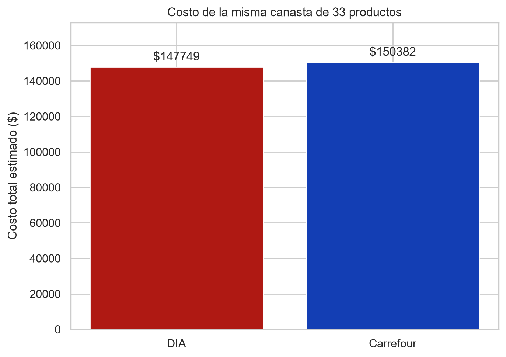
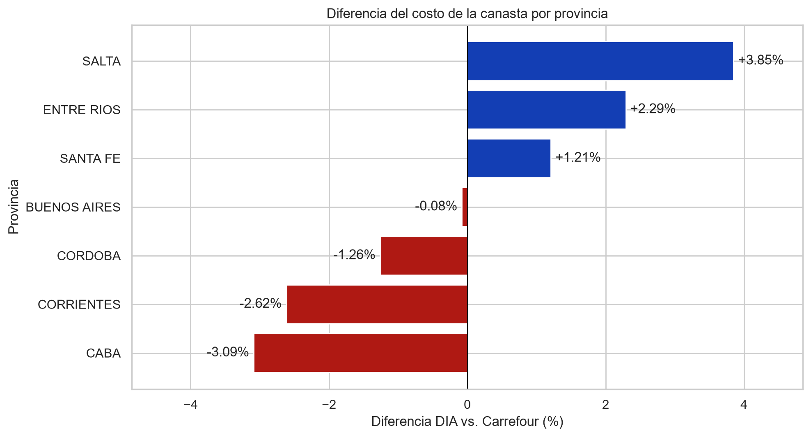

# Comparación de precios y promociones: DIA vs. Carrefour

## 📌 Descripción del proyecto

Este proyecto analiza y compara los precios de productos comercializados por **DIA** y **Carrefour** utilizando datos publicados por el **Sistema Electrónico de Publicidad de Precios Argentinos (SEPA)** correspondientes a **julio de 2026**.

Los datasets de productos utilizados superan en conjunto los **7,6 millones de registros**, lo que permite trabajar con un volumen significativo de datos reales y desarrollar un proyecto de análisis de datos de forma incremental.

El proyecto combina:

- preparación y limpieza de datos;
- control de calidad;
- integración de fuentes;
- análisis exploratorio de precios;
- análisis de promociones;
- normalización y validación geográfica;
- comparación de precios por provincia;
- construcción de categorías comerciales;
- procesamiento de lenguaje natural (NLP);
- clasificación automática mediante modelos de Machine Learning;
- construcción de una canasta comparable;
- visualización y comunicación de resultados.

El objetivo es construir un análisis **reproducible, documentado y basado en datos reales**, manteniendo una separación clara entre la preparación de los datos, el análisis descriptivo y las etapas posteriores de modelado.

---

## ⭐ Resultados destacados

| Indicador | Resultado |
|---|---|
| Registros de productos de origen | **Más de 7,6 millones**, entre ambas cadenas |
| Universo principal comparable | **2.220 productos idénticos**, presentes en las dos cadenas de **7 provincias** |
| Clasificación comercial | **5 categorías**; 400 etiquetas manuales y 1.820 asignaciones automáticas |
| Mejor modelo NLP/ML seleccionado | **TF-IDF (palabras + caracteres) + LinearSVC**, Macro F1 medio de **0,911** en validación cruzada repetida |
| Precio medio de los 2.220 artículos | **$5.102,43 DIA** frente a **$5.416,17 Carrefour** (**−5,79 %**) |
| Canasta exploratoria de 33 productos | **$147.749,30 DIA** frente a **$150.381,92 Carrefour** (**−1,75 %**) |
| Canasta por provincia | DIA presenta menor costo en **4 provincias**; Carrefour, en **3** |

Estas cifras corresponden a los **datos SEPA de julio de 2026** y a los universos definidos en cada análisis. La canasta de 33 artículos es una selección intencional de **una unidad comercial por producto**, sin ponderaciones de consumo; no representa una canasta básica oficial ni precios actuales.

### Visualizaciones del resultado final

**Comparación del costo de la canasta seleccionada**



**Diferencias porcentuales del costo de la misma canasta por provincia**



> Las figuras se exportan desde `notebooks/06_canasta_comparable_conclusiones.ipynb`. Para que se muestren en GitHub, deben estar disponibles en `outputs/figures/` con esos nombres.

---

## 🎯 Objetivos

Los objetivos generales del proyecto son:

- Integrar y preparar los datasets de productos de DIA y Carrefour.
- Identificar los productos presentes en ambas cadenas.
- Analizar la variabilidad de precios entre sucursales.
- Comparar precios de lista y precios efectivos.
- Analizar la frecuencia, profundidad y alcance de las promociones.
- Preparar y validar la información de sucursales para el análisis territorial.
- Identificar las provincias donde ambas cadenas tienen presencia comparable.
- Analizar las diferencias de precios entre DIA y Carrefour por provincia.
- Construir un conjunto de categorías comerciales para los productos.
- Etiquetar manualmente una muestra de productos para utilizarla como referencia.
- Aplicar técnicas de NLP y modelos de Machine Learning para completar automáticamente la categorización.
- Construir una canasta comparable entre ambas cadenas.
- Integrar los resultados en visualizaciones y conclusiones finales.

El proyecto busca demostrar competencias en:

- **Exploratory Data Analysis (EDA)**
- Limpieza y transformación de datos
- Integración de fuentes
- Análisis estadístico descriptivo
- Análisis de precios y promociones
- Normalización de datos geográficos
- Procesamiento de lenguaje natural (NLP)
- Clasificación de texto
- Machine Learning
- Visualización de datos
- Comunicación de resultados

---

## 🗺️ Etapas del proyecto

| Etapa | Contenido | Estado |
|---|---|---|
| 1 | Preparación, precios y promociones | ✅ Completada |
| 2 | Preparación de sucursales para análisis geográfico | ✅ Completada |
| 3 | Comparación y análisis de precios por provincia | ✅ Completada |
| 4 | Construcción de categorías de productos y etiquetado manual | ✅ Completada |
| 5 | Categorización de productos mediante NLP y ML | ✅ Completada |
| 6 | Canasta comparable y conclusiones finales | ✅ Completada |

La estructura del proyecto está organizada de manera incremental: cada etapa prepara los datos y resultados necesarios para la siguiente.

---

# 📊 Fuentes de datos

Este proyecto utiliza datos provenientes del **Sistema Electrónico de Publicidad de Precios Argentinos (SEPA)** con fecha **2026-07-03**, junto con archivos auxiliares utilizados para la normalización geográfica.

A continuación se detallan las fuentes utilizadas y su propósito.

---

## 🏛️ Provincias de Argentina — ISO 3166-2

**Archivo:** `data/metadata/provincias.csv`

**Fuente oficial:** Instituto Geográfico Nacional (IGN)

**Descarga:**  
https://infra.datos.gob.ar/catalog/modernizacion/dataset/7/distribution/7.7/download/provincias.csv

**Descripción:**

Contiene la lista de provincias de Argentina junto con sus códigos ISO 3166-2.

Se utiliza como referencia para:

- verificar los códigos provinciales presentes en SEPA;
- normalizar las referencias geográficas;
- unificar los códigos ISO con nombres de provincias;
- disponer de una nomenclatura común para el análisis posterior.

Este archivo se utiliza como **referencia geográfica auxiliar** y no reemplaza la inspección de los datos originales de SEPA.

---

## 🛒 SEPA — Sistema Electrónico de Publicidad de Precios Argentinos

**Archivos originales:**

```text
data/raw/productos_dia.csv
data/raw/productos_carrefour.csv
data/raw/sucursales_dia.csv
data/raw/sucursales_carrefour.csv
```

**Fuente:** Secretaría de Comercio de la Nación — Sistema SEPA

Los archivos contienen información relacionada con:

- productos;
- precios;
- promociones;
- identificadores de productos;
- identificadores de comercio;
- identificadores de sucursales;
- información de ubicación de las sucursales.

Los archivos de productos son de gran tamaño y se mantienen fuera del repositorio cuando su volumen dificulta su distribución.

Los archivos de sucursales son de menor tamaño y se utilizan para desarrollar el análisis geográfico.

---

## 🧹 Archivos procesados

**Carpeta:** `data/processed/`

Los archivos procesados se generan a partir de los datasets originales después de aplicar las transformaciones necesarias para el análisis.

Entre los productos procesados utilizados en las etapas posteriores se encuentran:

```text
productos_dia_procesado.parquet
productos_carrefour_procesado.parquet
```

Estos archivos contienen el universo de productos utilizado en la comparación desarrollado durante la primera etapa.

Entre los archivos utilizados en las **Etapas 3 a 6** también se encuentran:

```text
precios_producto_provincia_7.parquet
productos_etiquetados_parcialmente.xlsx
productos_media_y_categorizados.parquet
catalogo_seleccion_canasta.xlsx
canasta_seleccionada.xlsx
```

- `precios_producto_provincia_7.parquet`: precios efectivos medios por producto, provincia y cadena del universo homogéneo de 2.220 productos; se reutiliza para comparar el costo provincial de la canasta.
- `productos_etiquetados_parcialmente.xlsx`: reúne los 2.220 productos del universo principal y las 400 categorías asignadas manualmente en la Etapa 4; es la entrada del notebook de clasificación.
- `productos_media_y_categorizados.parquet`: salida de la Etapa 5, con los 2.220 productos, su categoría, descripción de Carrefour y precios medios consolidados de ambas cadenas; es la base principal de la Etapa 6.
- `catalogo_seleccion_canasta.xlsx`: catálogo auxiliar de los 2.220 artículos con **solo ID y descripción**, sin precios, generado para elegir la canasta.
- `canasta_seleccionada.xlsx`: selección manual definitiva de **33 productos**, con `id_producto` y `descripcion_carrefour`, sin precios; estos se incorporan después por ID desde el Parquet.

Los archivos auxiliares Excel de la canasta permiten documentar y reproducir la selección sin visualizar el precio de ninguna cadena durante esa decisión.

El formato **Parquet** permite trabajar con los datos procesados de manera más eficiente que con los archivos CSV originales y facilita la continuidad entre notebooks.

---

# 📏 Unidad de análisis

Para el análisis de precios, una observación representa:

> **un producto determinado en una sucursal determinada.**

La combinación:

```text
id_producto + id_sucursal
```

se utiliza como referencia para identificar una observación producto–sucursal.

Esto es importante porque un mismo producto puede aparecer en múltiples sucursales y, por lo tanto, permite estudiar la variabilidad del precio entre distintos puntos de venta.

Los productos comunes entre DIA y Carrefour se identifican mediante `id_producto`.

---

# 🔎 Etapa 1 — Preparación, precios y promociones

La primera etapa estuvo orientada a transformar los archivos originales de productos en un conjunto de datos adecuado para el análisis comparativo.

## Actividades realizadas

- Carga de los datasets.
- Tratamiento de los campos como texto durante la importación.
- Identificación y eliminación de registros que no corresponden a productos.
- Revisión de valores nulos.
- Control de duplicados.
- Identificación de productos comunes entre DIA y Carrefour.
- Selección de variables relevantes.
- Construcción del precio efectivo.
- Análisis de la dispersión de precios.
- Análisis de promociones.
- Evaluación de la profundidad y alcance de `promo1`.

Los productos comunes se identifican mediante `id_producto`, por lo que los resultados comparativos de esta etapa corresponden al **universo de productos comunes identificado en los datasets analizados**.

---

## 💰 Dispersión de precios

### Rango porcentual

Se utiliza `rango_pct` para medir la diferencia entre el precio máximo y mínimo observado para un producto:

```text
(max - min) / max × 100
```

Esta métrica representa la **brecha entre el precio mínimo y máximo como porcentaje del precio máximo**.

Un rango elevado indica una diferencia importante entre los precios extremos observados para un mismo producto.

El rango no permite por sí solo determinar el origen de una diferencia. Por ese motivo se complementa con otras métricas y con el análisis de precios de lista, precios efectivos y promociones.

---

## 📐 Coeficiente de variación

También se utiliza el **coeficiente de variación (CV)**:

```text
CV = desviación estándar / media
```

El CV permite analizar la dispersión relativa teniendo en cuenta el nivel promedio de precios.

El rango porcentual y el CV se utilizan como métricas complementarias y no representan exactamente el mismo fenómeno.

---

## 🏷️ Precio de lista y precio efectivo

El análisis diferencia entre:

- **Precio de lista**
- **Precio efectivo**

Para este proyecto, el `precio_efectivo` se construye tomando el menor valor entre el precio de lista y el precio correspondiente a `promo1`.

`promo2` se mantiene separada debido a sus características particulares y no se incorpora automáticamente al cálculo general del precio efectivo.

Esta separación permite estudiar:

1. la dispersión de los precios de lista;
2. la dispersión observada al incorporar `promo1`;
3. la profundidad de los descuentos.

La comparación entre precio de lista y precio efectivo es **descriptiva** y no se utiliza para establecer relaciones causales.

---

## 🎟️ Promociones

Las promociones se analizan separando diferentes dimensiones.

### `promo1`

Se utiliza para estudiar las promociones incorporadas al análisis del `precio_efectivo`.

Se analiza:

- frecuencia;
- profundidad del descuento;
- presencia entre sucursales;
- diferencias entre DIA y Carrefour.

### `promo2`

Se mantiene como una variable independiente.

Dentro del universo de productos comunes analizado se observó presencia de `promo2` en DIA y ausencia de registros de `promo2` en Carrefour.

Esta observación corresponde exclusivamente al **dataset y universo analizado** y no implica que una cadena no utilice ese tipo de promoción fuera de los registros considerados.

---

## 📉 Frecuencia, profundidad y alcance

El proyecto separa tres dimensiones de las promociones:

| Dimensión | Pregunta |
|---|---|
| Frecuencia | ¿Con qué frecuencia aparece una promoción? |
| Profundidad | ¿Cuánto se reduce el precio? |
| Alcance | ¿En qué proporción de sucursales aparece? |

La profundidad del descuento se calcula sobre las observaciones que presentan `promo1`.

También se analizó específicamente la proporción de descuentos superiores al **65%**, informando tanto la cantidad de observaciones como el total utilizado como denominador.

Esta separación evita asumir que un descuento elevado necesariamente se encuentra extendido a todas las sucursales.

---

## 🏪 Alcance de `promo1` entre sucursales

Para analizar los descuentos más elevados se seleccionaron los **15 productos con mayor descuento `promo1` observado** para cada cadena.

La selección se realiza tomando el máximo descuento registrado entre las sucursales de cada producto.

> Este TOP 15 identifica los mayores descuentos puntuales observados por producto. No representa necesariamente los productos con mayor descuento promedio entre sucursales.

También se calcula:

```text
frac_sucursales_con_promo
```

Esta variable representa la proporción de observaciones del producto que registra `promo1`.

Dado que se controla previamente la unicidad de `id_producto + id_sucursal`, esta proporción puede interpretarse como la proporción de sucursales observadas en las que aparece `promo1`.

---

## 📌 Principales hallazgos de la Etapa 1

Dentro del universo de productos comunes analizado:

- Carrefour presenta una **mayor heterogeneidad de precios entre sucursales** en las métricas de dispersión estudiadas.
- La comparación entre precio de lista y precio efectivo muestra que la dispersión puede analizarse desde más de una dimensión.
- DIA presenta una **mayor proporción de observaciones con promociones** cuando se consideran conjuntamente `promo1` y `promo2`.
- Al comparar exclusivamente `promo1`, la diferencia de frecuencia promocional se mantiene, aunque con una base de comparación más homogénea.
- DIA presenta una mayor profundidad promedio de `promo1` en el universo analizado.
- Carrefour presenta una proporción relativa mayor de observaciones con descuentos extremos superiores al 65%, aunque representan una fracción minoritaria de sus observaciones promocionadas.
- El análisis del alcance muestra que **profundidad y extensión de una promoción son dimensiones diferentes**.
- El rango de precios por sí solo no permite establecer el origen de las diferencias observadas.

Estas conclusiones se mantienen como resultados **descriptivos del período y universo analizados**, sin atribuir causalidad a las promociones ni a otras características comerciales.

---

# 🏪 Etapa 2 — Preparación de sucursales para análisis geográfico

La segunda etapa tuvo como objetivo preparar los datasets de sucursales de DIA y Carrefour para poder incorporar posteriormente la dimensión territorial al análisis de precios.

El trabajo no consistió simplemente en convertir códigos ISO en nombres de provincias. Fue necesario realizar una **inspección y normalización de las referencias geográficas**, ya que se detectaron inconsistencias en los datos originales.

---

## 🔍 Inspección de los códigos provinciales

Durante la inspección de los valores únicos de `sucursales_provincia` se detectaron códigos ISO utilizados de manera inconsistente.

Por este motivo, se decidió **verificar y corregir las provincias una por una**, antes de realizar la conversión definitiva a nombres.

Esta estrategia permite evitar imputaciones automáticas que podrían trasladar errores del dataset original al análisis posterior.

---

## 🧩 Función auxiliar de inspección

Dado que el procedimiento de revisión debía repetirse para distintos códigos de provincia y para ambas cadenas, se creó una función auxiliar en:

```text
src/inspeccion.py
```

La función centraliza la lógica utilizada durante la inspección de las sucursales y permite:

- reducir la duplicación de código;
- mantener los notebooks más limpios;
- aplicar un procedimiento homogéneo;
- facilitar la trazabilidad de las verificaciones;
- organizar mejor el proceso de normalización geográfica.

---

## ⚠️ Principales inconsistencias detectadas

### DIA — código `AR-J`

Se detectó que DIA utilizaba `AR-J` para sucursales de **Jujuy**, mientras que según ISO 3166-2 `AR-J` corresponde a **San Juan**.

La inspección mostró que las sucursales de DIA bajo ese código correspondían a Jujuy, por lo que fueron normalizadas como:

```text
AR-Y → JUJUY
```

Esto fue relevante porque Carrefour sí utilizaba `AR-J` para San Juan. Por lo tanto, San Juan no formaba parte del territorio común comparable entre ambas cadenas.

---

### Carrefour — código `AR-A`

Se detectaron sucursales de Carrefour asignadas a `AR-A` que pertenecían a:

- Buenos Aires;
- Salta;
- Jujuy.

Como `AR-A` corresponde a Salta, fue necesario revisar individualmente las localidades y reasignar los casos incorrectos.

Entre estas correcciones se identificó una sucursal de Jujuy que permitió incorporar correctamente a Jujuy al territorio común de comparación.

---

### Carrefour — código `AR-B`

Dentro de las sucursales asignadas a `AR-B`, correspondiente a Buenos Aires, se detectaron localidades como:

- Neuquén;
- La Pampa.

Estos registros fueron revisados y corregidos antes de continuar con la normalización.

---

### Carrefour — código `AR-C`

El código `AR-C`, correspondiente a CABA, presentaba múltiples registros pertenecientes a otras provincias.

La inspección permitió identificar sucursales de:

- Córdoba;
- San Luis;
- Buenos Aires;
- Chubut.

Las asignaciones fueron corregidas de acuerdo con la ubicación real de las sucursales.

---

## 🗺️ Normalización de nombres de provincias

Una vez corregidas las inconsistencias relevantes, se creó una columna común:

```text
provincia
```

Esta columna contiene los nombres normalizados de las provincias y se utiliza como referencia geográfica para las etapas posteriores.

La normalización incluye:

- conversión a mayúsculas;
- eliminación de tildes;
- unificación de nombres;
- ajustes específicos para mantener consistencia entre datasets.

Por ejemplo:

```text
AR-S → SANTA FE
AR-X → CORDOBA
AR-Y → JUJUY
AR-C → CABA
```

La columna original `sucursales_provincia` se conserva como referencia del dato de origen.

---

## 🌎 Verificación mediante coordenadas

Después de la normalización se realizó una verificación adicional sobre Carrefour utilizando rangos aproximados de:

- latitud;
- longitud.

Estos rangos se utilizaron como **filtros de detección de posibles anomalías**, no como límites administrativos oficiales de las provincias.

El objetivo fue localizar sucursales cuya ubicación geográfica pudiera no coincidir con la provincia asignada.

El control detectó un caso que requirió revisión:

```text
id_sucursal = 172
```

La inspección de la dirección y de las coordenadas mostró que la sucursal correspondía a **Mendoza** y no a la provincia previamente asignada.

La provincia fue corregida a:

```text
AR-M → MENDOZA
```

---

## 🛒 Exclusión de registros de tiendas online

También se verificó la existencia de registros que pudieran representar tiendas virtuales y no puntos de venta físicos.

La búsqueda se realizó sobre:

```text
sucursales_nombre
sucursales_tipo
```

utilizando patrones relacionados con términos como:

```text
e-commerce
online
web
delivery
virtual
```

En Carrefour no se detectaron coincidencias mediante este procedimiento.

En DIA se detectó un registro identificado como:

```text
id_sucursal = 90000
```

correspondiente a `eCommerce`.

Este registro fue excluido porque no representa una ubicación física y podría distorsionar el análisis territorial.

---

## 🗺️ Territorio común entre DIA y Carrefour

Una vez realizadas las correcciones, se calculó la intersección entre las provincias presentes en ambos datasets.

Se creó la variable:

```python
provincias_comunes
```

que contiene los **nombres normalizados de las 8 provincias coincidentes** entre DIA y Carrefour.

Las provincias son:

| Código ISO | Provincia normalizada |
|---|---|
| `AR-A` | SALTA |
| `AR-B` | BUENOS AIRES |
| `AR-C` | CABA |
| `AR-E` | ENTRE RIOS |
| `AR-S` | SANTA FE |
| `AR-W` | CORRIENTES |
| `AR-X` | CORDOBA |
| `AR-Y` | JUJUY |

### `provincias_coincidentes` vs. `provincias_comunes`

Durante el proceso se utilizó inicialmente una variable denominada:

```text
provincias_coincidentes
```

que contenía los **códigos ISO** de las provincias coincidentes.

Una vez creada y depurada la columna `provincia`, se decidió trabajar con los **nombres normalizados** para las etapas posteriores.

Por este motivo se creó:

```text
provincias_comunes
```

Esta variable contiene los nombres de las ocho provincias coincidentes y permite utilizar directamente la columna `provincia` ya normalizada.

---

## 🏪 Sucursales de las provincias comunes

A partir de `provincias_comunes` se construyeron dos subconjuntos:

```text
sucursales_dia_8
sucursales_carrefour_8
```

Estos datasets contienen exclusivamente las sucursales de DIA y Carrefour ubicadas en las ocho provincias comunes.

Se mantienen separados de los datasets originales para conservar la trazabilidad del proceso y permitir que las fuentes completas puedan seguir utilizándose en otros análisis.

---

## 🔗 Integración de productos y sucursales

Finalmente, los productos procesados se integraron con las sucursales correspondientes mediante `id_sucursal`.

La integración utiliza un `inner merge` para conservar únicamente las observaciones de productos pertenecientes a sucursales incluidas en el territorio común.

Se obtuvieron los siguientes resultados:

### DIA

- Sucursales en provincias coincidentes: **982**
- Sucursales presentes en el dataset integrado: **982**

### Carrefour

- Sucursales en provincias coincidentes: **648**
- Sucursales presentes en el dataset integrado: **633**
- Sucursales sin registros dentro del subconjunto de productos comunes: **15**

La diferencia de Carrefour se interpreta en relación con el recorte utilizado: `productos_carrefour_comunes` contiene únicamente el universo de productos comunes utilizado para la comparación, por lo que algunas sucursales pueden no presentar observaciones dentro de ese subconjunto aunque sí existan en el dataset completo de sucursales.

La integración deja preparados los datos para incorporar la dimensión provincial al análisis de precios.

---

# 📍 Etapa 3 — Comparación y análisis de precios por provincia

**Estado: ✅ Completada**

La tercera etapa incorporó la dimensión territorial al análisis de precios entre DIA y Carrefour. Para ello se integró la información de productos con los datos de sucursales preparados en la Etapa 2 y se construyeron universos comparables a nivel de **producto, provincia y cadena**.

El análisis mantuvo como unidad de observación el **producto–sucursal**, pero realizó agregaciones posteriores a nivel de producto–provincia–cadena para comparar los precios de los mismos productos en territorios equivalentes.

El objetivo principal fue determinar cómo varían los precios entre DIA y Carrefour según la provincia, analizar la dispersión territorial y estudiar si los patrones observados se mantienen al cambiar la escala geográfica.

---

## 🔎 Construcción del universo comparable

La exploración inicial identificó **19.368 pares producto–provincia** con información comparable entre ambas cadenas dentro de las ocho provincias analizadas.

Antes de construir los universos definitivos se revisaron las diferencias porcentuales extremas. Se detectaron **33 pares producto–provincia** con `|diferencia_pct| > 500%`, correspondientes a **5 productos**.

Estos productos fueron excluidos de los universos posteriores para evitar que diferencias relativas excepcionalmente grandes tuvieran una influencia desproporcionada sobre los indicadores agregados. La exclusión constituye una decisión metodológica de control de valores extremos y no implica afirmar que los registros originales sean necesariamente errores.

Luego del filtrado se construyeron dos universos con cobertura completa:

| Universo | Productos | Uso |
|---|---:|---|
| 8 provincias | **1.662** | Análisis complementario de sensibilidad |
| 7 provincias, sin Jujuy | **2.220** | Universo principal |

El universo de 7 provincias incorpora **558 productos adicionales**, equivalentes a un **33,57% más** respecto del universo de 8 provincias.

Se adoptó el universo de 7 provincias como referencia principal debido a la cobertura limitada de Carrefour en Jujuy. El universo de 8 provincias se conserva como análisis de sensibilidad para observar el efecto de incluir esa provincia.

---

## 📍 Nivel medio de precios por provincia — universo flexible

Además del universo homogéneo utilizado en la comparación principal, se calculó el nivel medio de precios de cada cadena dentro de cada provincia utilizando un **universo flexible de 8 provincias**. En este análisis no se exige que cada producto esté presente en todas las provincias: solo se requiere que pueda compararse entre DIA y Carrefour dentro de una misma provincia.

Para cada combinación de `provincia + id_producto + cadena`, primero se calcula el precio medio del producto entre las sucursales disponibles. Luego se calcula la media y la mediana provincial de esos precios por producto. De esta forma, cada producto tiene el mismo peso dentro de la provincia, independientemente de cuántas sucursales lo comercialicen.

### Comparación de precios medios

La diferencia porcentual se calcula tomando a Carrefour como referencia:

`Diferencia % = (precio_DIA - precio_Carrefour) / precio_Carrefour × 100`

Los valores negativos indican un precio medio menor en DIA; los positivos indican un precio medio menor en Carrefour.

| Provincia | Precio medio DIA | Precio medio Carrefour | Diferencia |
|---|---:|---:|---:|
| CABA | $5.125,34 | $5.493,11 | **−6,70%** |
| Corrientes | $5.154,72 | $5.505,02 | **−6,36%** |
| Córdoba | $5.122,80 | $5.428,62 | **−5,63%** |
| Buenos Aires | $5.090,94 | $5.362,60 | **−5,07%** |
| Santa Fe | $5.138,23 | $5.389,65 | **−4,66%** |
| Entre Ríos | $5.103,19 | $5.284,00 | **−3,42%** |
| Salta | $5.187,37 | $5.359,54 | **−3,21%** |
| Jujuy | $4.991,47 | $4.759,10 | **+4,88%** |

En **7 de las 8 provincias**, DIA presenta un precio medio inferior al de Carrefour. La mayor diferencia favorable a DIA se observa en CABA (−6,70%), seguida por Corrientes (−6,36%) y Córdoba (−5,63%). **Jujuy es la excepción**: allí, el precio medio de DIA resulta 4,88% superior al de Carrefour.

La comparación de medianas mantiene el mismo sentido general: DIA presenta una mediana inferior en las mismas siete provincias, mientras que Jujuy conserva el patrón inverso. Esto aporta consistencia descriptiva al patrón, aunque la media continúa siendo la medida principal del proyecto.

### Alcance de la comparación provincial

El universo flexible permite comparar el nivel medio de precios entre **DIA y Carrefour dentro de cada provincia**, porque ambas cadenas se evalúan sobre los mismos productos disponibles en ese territorio.

Sin embargo, la **cantidad y composición de los productos varía entre provincias**. Por este motivo, estos promedios no se utilizan para establecer qué provincias son más caras o más baratas entre sí. Para ese objetivo se construye más adelante un **ranking provincial homogéneo**, utilizando los mismos **1.662 productos en las ocho provincias**.

---

## 📊 Comparación de precios entre DIA y Carrefour por provincia

La comparación se realizó producto contra producto dentro de cada provincia. Para cada combinación `provincia + id_producto` se calculó el precio medio observado en cada cadena y posteriormente la diferencia porcentual:

```text
Diferencia % = (precio_DIA - precio_Carrefour) / precio_Carrefour × 100
```

Con esta definición:

- valores negativos indican que **DIA presenta un precio menor**;
- valores positivos indican que **Carrefour presenta un precio menor**.

En el universo principal de 7 provincias, la diferencia media fue negativa en todas las provincias:

| Provincia | Diferencia media DIA vs. Carrefour |
|---|---:|
| CABA | **−5,52%** |
| Corrientes | **−4,59%** |
| Córdoba | **−4,34%** |
| Buenos Aires | **−3,49%** |
| Santa Fe | **−2,52%** |
| Entre Ríos | **−1,67%** |
| Salta | **−1,42%** |

Dentro del universo comparable definido, esto indica una diferencia media favorable a DIA en las siete provincias analizadas.

La proporción de productos en los que DIA presenta un precio menor también varía territorialmente:

- Corrientes: **61,26%**
- CABA: **60,59%**
- Córdoba: **59,46%**
- Santa Fe: **53,20%**
- Entre Ríos: **52,66%**
- Buenos Aires: **47,48%**
- Salta: **44,68%**

Por lo tanto, la ventaja media de DIA no implica que sea más barato en todos los productos ni que tenga la misma intensidad en todas las provincias.

---

## 📐 Media y mediana

La **media** se mantuvo como medida principal del proyecto y la **mediana** se utilizó como medida complementaria para evaluar la robustez de las conclusiones.

Las medianas de las diferencias porcentuales en el universo de 7 provincias fueron:

| Provincia | Diferencia mediana DIA vs. Carrefour |
|---|---:|
| CABA | **−2,66%** |
| Córdoba | **−2,44%** |
| Corrientes | **−0,95%** |
| Entre Ríos | **−0,33%** |
| Santa Fe | **−0,21%** |
| Buenos Aires | **+0,13%** |
| Salta | **+0,88%** |

La diferencia entre media y mediana es relevante: mientras la media resulta favorable a DIA en las siete provincias, la mediana es mucho más cercana a cero y resulta ligeramente positiva en Buenos Aires y Salta.

Esto indica que la ventaja observada mediante la media **no es uniforme a lo largo de toda la distribución de productos** y que algunas diferencias de mayor magnitud influyen sobre el promedio.

---

## 🗺️ Sensibilidad al incluir Jujuy

El universo de 8 provincias permitió comprobar que Jujuy presenta un comportamiento diferente al resto del territorio analizado.

Los resultados para Jujuy fueron:

- diferencia media: **+8,45%**;
- diferencia mediana: **+8,28%**;
- DIA es más barato en **26,84%** de los productos;
- Carrefour es más barato en aproximadamente **70%** de los productos.

El signo positivo indica que, dentro del universo comparable de Jujuy, **Carrefour presenta precios inferiores a DIA**.

Este comportamiento modifica de manera importante la comparación general cuando Jujuy se incorpora al universo. Por este motivo, el análisis de 8 provincias se conserva como sensibilidad y el de 7 provincias se utiliza como referencia principal.

---

## 🌎 Dispersión territorial de los mismos productos

Se analizó también cómo cambia el precio de un mismo producto entre las distintas provincias.

Para ello se utilizó:

```text
rango_pct = (máximo - mínimo) / máximo × 100
```

La mediana del rango porcentual territorial fue:

| Cadena | Mediana del rango territorial |
|---|---:|
| DIA | **3,61%** |
| Carrefour | **9,21%** |

Esto muestra que, dentro del universo analizado, **Carrefour presenta una mayor dispersión territorial de precios para los mismos productos**.

El resultado es descriptivo: el rango permite medir la magnitud de la variación, pero no permite determinar por sí solo las causas de esas diferencias.

---

## 🏪 Dispersión entre sucursales dentro de cada provincia

También se estudió la variación de precios entre sucursales de una misma cadena dentro de cada provincia.

### Carrefour

| Provincia | Mediana del rango entre sucursales |
|---|---:|
| Buenos Aires | **16,20%** |
| Córdoba | **12,27%** |
| CABA | **9,73%** |
| Entre Ríos | **7,96%** |
| Santa Fe | **5,07%** |
| Salta | **0,99%** |
| Corrientes | **0%** |

### DIA

| Provincia | Mediana del rango entre sucursales |
|---|---:|
| Salta | **3,20%** |
| Buenos Aires | **1,95%** |
| CABA | **1,95%** |
| Córdoba | **0%** |
| Corrientes | **0%** |
| Entre Ríos | **0%** |
| Santa Fe | **0%** |

El patrón general muestra una mayor dispersión interna en Carrefour en varias provincias, mientras que DIA presenta valores más reducidos en la mayoría de los territorios.

Esta comparación debe interpretarse teniendo en cuenta la cantidad de sucursales disponibles. Un rango de 0% en una provincia con pocas sucursales no demuestra que una cadena mantenga precios idénticos en todo el territorio.

---

## 🧭 Análisis regional

Como complemento del análisis provincial se agruparon las ocho provincias en tres regiones:

| Región | Provincias |
|---|---|
| **METROPOLITANA** | Buenos Aires, CABA |
| **CENTRO–LITORAL** | Córdoba, Santa Fe, Entre Ríos, Corrientes |
| **NOA** | Jujuy, Salta |

El análisis regional utilizó el universo de **1.662 productos con cobertura completa en las ocho provincias**.

Para evitar que una región recibiera mayor peso simplemente por tener más provincias, primero se calculó el precio medio de cada producto dentro de cada provincia y luego se promediaron las provincias pertenecientes a cada región. De esta forma, cada provincia tiene el mismo peso dentro de su región.

Los resultados fueron:

| Región | Precio medio DIA | Precio medio Carrefour | Diferencia media |
|---|---:|---:|---:|
| CENTRO–LITORAL | $4.895,57 | $5.136,69 | **−3,34%** |
| METROPOLITANA | $4.898,10 | $5.199,96 | **−4,54%** |
| NOA | $5.012,32 | $4.985,51 | **+2,79%** |

En **METROPOLITANA** y **CENTRO–LITORAL**, DIA presenta precios medios regionales inferiores a Carrefour.

En **NOA**, Carrefour presenta un precio medio regional ligeramente inferior a DIA.

La proporción de productos en los que DIA resulta más barato también varía:

- METROPOLITANA: **58,12%**
- CENTRO–LITORAL: **55,05%**
- NOA: **30,93%**

El análisis regional confirma que la relación de precios entre ambas cadenas cambia según el territorio.

### Índice regional

Tomando como referencia 100 la región más barata de cada cadena:

**DIA**

- CENTRO–LITORAL: **100,00**
- METROPOLITANA: **100,05**
- NOA: **102,38**

**Carrefour**

- NOA: **100,00**
- CENTRO–LITORAL: **103,03**
- METROPOLITANA: **104,30**

La región de menor nivel de precios no es la misma para ambas cadenas. En DIA, Centro–Litoral y Metropolitana presentan niveles prácticamente iguales, mientras que NOA se encuentra por encima. En Carrefour, NOA es la región de menor nivel relativo y Metropolitana la de mayor nivel.

Este índice es descriptivo y no representa un índice de costo de vida, participación de mercado ni una canasta de consumo ponderada.

## 📊 Ranking provincial por cadena — universo homogéneo de 8 provincias

Como complemento del análisis regional, se elaboró un ranking de nivel medio de precios por provincia para cada cadena, utilizando **exactamente los mismos 1.662 productos en las ocho provincias**. Primero se considera el precio medio de cada producto en cada provincia y cadena y luego se promedian los productos, otorgando el mismo peso a cada uno. Así se evita que las diferencias de surtido entre provincias determinen el orden del ranking.

Las posiciones se calculan **por separado para cada cadena**, de menor a mayor precio medio:

| Posición | Provincia — DIA | Precio medio DIA | Provincia — Carrefour | Precio medio Carrefour |
|---:|---|---:|---|---:|
| 1 | Buenos Aires | $4.894,96 | Jujuy | $4.783,70 |
| 2 | Entre Ríos | $4.895,07 | Entre Ríos | $5.015,29 |
| 3 | Córdoba | $4.895,50 | Santa Fe | $5.107,69 |
| 4 | Santa Fe | $4.895,71 | Buenos Aires | $5.134,55 |
| 5 | Corrientes | $4.895,99 | Salta | $5.187,31 |
| 6 | CABA | $4.901,24 | Córdoba | $5.196,81 |
| 7 | Jujuy | $5.000,19 | Corrientes | $5.226,98 |
| 8 | Salta | $5.024,45 | CABA | $5.265,37 |

En **Carrefour**, Jujuy presenta el menor precio medio y CABA el mayor: la diferencia respecto de Jujuy es del **10,07%**. En **DIA**, Buenos Aires registra el menor precio medio y Salta el mayor, con una diferencia del **2,65%**. Las primeras seis provincias de DIA tienen precios medios muy próximos entre sí.

El ranking muestra una **mayor amplitud territorial de precios medios en Carrefour** que en DIA para este conjunto idéntico de productos. Es una comparación descriptiva de promedios sin ponderación por hábitos de consumo y no equivale a un índice de costo de vida.

---

## 📌 Principales hallazgos de la Etapa 3

1. La exploración inicial identificó **19.368 pares producto–provincia** comparables. Se detectaron **33 pares extremos**, correspondientes a **5 productos**, con `|diferencia_pct| > 500%`; esos productos se excluyeron de los universos posteriores como decisión de control de valores extremos, sin afirmar que los datos originales fueran necesariamente errores.

2. Se construyeron dos universos homogéneos: **2.220 productos con cobertura completa en 7 provincias** y **1.662 productos con cobertura completa en 8 provincias**. Excluir Jujuy del requisito de cobertura completa incorpora **558 productos adicionales (+33,57%)**. El universo de 7 provincias es la referencia principal y el de 8 se conserva como sensibilidad.

3. En el **universo flexible de 8 provincias**, DIA presenta un precio medio inferior a Carrefour en 7 provincias; Jujuy es la excepción. Este resultado compara las dos cadenas **dentro de cada provincia** y no debe interpretarse como un ranking de provincias, porque la composición de productos cambia entre territorios.

4. En la comparación producto contra producto del **universo homogéneo de 7 provincias**, la diferencia media porcentual favorece a DIA en las siete provincias. La mediana, sin embargo, es mucho más cercana a cero y resulta ligeramente favorable a Carrefour en Buenos Aires y Salta; por eso la conclusión se refiere a la diferencia media del universo y no a una ventaja uniforme en todos los productos.

5. Jujuy presenta un comportamiento diferencial en el universo homogéneo de 8 provincias: la diferencia media es **+8,45%**, la mediana **+8,28%**, DIA es más barato en **26,84%** de los productos y Carrefour en **70,04%**. Esto respalda mantener el universo de 8 provincias como análisis de sensibilidad.

6. Carrefour presenta mayor dispersión territorial para los mismos productos: la mediana del rango porcentual entre provincias es **9,21%**, frente a **3,61%** para DIA. La dispersión entre sucursales dentro de las provincias también es generalmente mayor en Carrefour, aunque debe interpretarse teniendo en cuenta la cobertura desigual de sucursales y los casos con pocas observaciones.

7. El análisis regional, realizado sobre los **1.662 productos con cobertura completa en las ocho provincias** y otorgando el mismo peso a cada provincia dentro de su región, muestra que DIA presenta precios medios inferiores en **Metropolitana (−4,54%)** y **Centro–Litoral (−3,34%)**. En **NOA**, Carrefour presenta un precio medio inferior, con una diferencia de **+2,79%** para DIA.

8. El **ranking provincial homogéneo de 1.662 productos en ocho provincias** permite comparar el nivel de precios entre territorios sin modificar el conjunto de productos. En **Carrefour**, Jujuy presenta el menor precio medio y CABA el mayor (**+10,07%** respecto de Jujuy); en **DIA**, Buenos Aires presenta el menor y Salta el mayor (**+2,65%** respecto de Buenos Aires). La amplitud territorial es mayor en Carrefour.

9. En conjunto, los resultados muestran que la relación de precios entre DIA y Carrefour depende del territorio y de la escala de análisis. La comparación entre cadenas dentro de cada provincia, el ranking provincial homogéneo, la comparación producto a producto y los indicadores de dispersión responden preguntas complementarias.

---

# 🏷️ Etapa 4 — Construcción de categorías de productos

**Estado: ✅ Completada**

La Etapa 4 tuvo como objetivo construir una clasificación comercial propia para el universo principal de **2.220 productos comparables**, utilizando como base el dataset de precios de siete provincias definido en la Etapa 3. Para cada producto se consolidó la información descriptiva y la marca reportada por las cadenas, junto con los precios medios de DIA y Carrefour.

Como SEPA no proporciona una clasificación comercial suficientemente detallada y homogénea para los objetivos del proyecto, se definió una taxonomía propia de cinco categorías. Luego se preparó un archivo para realizar el etiquetado manual y se verificó formalmente la consistencia de las etiquetas asignadas.

## Categorías definidas

| Categoría | Alcance | Ejemplos |
|---|---|---|
| **ALIMENTOS** | Productos destinados al consumo humano, incluidos frescos, refrigerados, congelados, secos, conservables y golosinas. | Carnes, frutas, verduras, lácteos, arroz, fideos, galletitas, chocolates y alfajores. |
| **BEBIDAS** | Productos destinados principalmente a ser consumidos como bebida, independientemente de su formato. | Agua, gaseosas, jugos, bebidas energéticas y jugo en polvo. |
| **PERFUMERIA Y LIMPIEZA** | Productos de higiene corporal, cuidado personal, limpieza del hogar y absorbentes. | Shampoo, jabón, pasta dental, desodorante, pañales, papel higiénico, rollo de cocina, detergente y lavandina. |
| **MASCOTAS** | Productos destinados a la alimentación, higiene y cuidado de animales domésticos. | Alimento balanceado, snacks, arena sanitaria y accesorios básicos para mascotas. |
| **OTROS** | Categoría residual para artículos que no corresponden a las categorías anteriores. | Pilas, juguetes, descartables, bombillas, film, aluminio y artículos de bazar. |

### Reglas de clasificación

- Cada producto recibe una sola categoría, según su naturaleza y finalidad principal.
- Los alimentos para consumo humano se clasifican en **ALIMENTOS**, incluidos los lácteos y la leche en polvo.
- Los jugos en polvo se clasifican en **BEBIDAS**.
- La higiene personal y la limpieza del hogar se agrupan en **PERFUMERIA Y LIMPIEZA**.
- Los productos destinados a animales domésticos se mantienen separados en **MASCOTAS**.
- Los artículos de uso general que no encajan en las categorías anteriores se asignan a **OTROS**.
- Los criterios se aplican de forma uniforme a los productos de ambas cadenas.

La estructura de cinco categorías simplifica el etiquetado manual y conserva una separación útil entre los principales rubros comerciales. La categoría **OTROS** es residual y heterogénea, mientras que **MASCOTAS** tiene una representación menor en la muestra etiquetada; ambas circunstancias deberán considerarse al evaluar el modelo en la Etapa 5.

## Etiquetado manual y validación

Se preparó un archivo con los **2.220 productos** para asignar manualmente una categoría a cada uno. Posteriormente, se cargó la versión parcialmente etiquetada y se controló que las etiquetas correspondieran a la taxonomía oficial.

Al finalizar esta etapa, el estado del etiquetado es el siguiente:

| Indicador | Resultado |
|---|---:|
| Universo total de productos | **2.220** |
| Productos etiquetados manualmente | **400 (18,0%)** |
| Productos pendientes de clasificación | **1.820 (82,0%)** |
| Etiquetas fuera de la taxonomía | **0** |

La distribución de los 400 productos etiquetados es:

| Categoría | Productos | Porcentaje |
|---|---:|---:|
| ALIMENTOS | 184 | 46,0% |
| BEBIDAS | 62 | 15,5% |
| PERFUMERIA Y LIMPIEZA | 115 | 28,75% |
| MASCOTAS | 27 | 6,75% |
| OTROS | 12 | 3,0% |
| **Total** | **400** | **100%** |

El control confirma que las 400 etiquetas asignadas pertenecen a las cinco categorías permitidas. Esto verifica la **validez formal** de las etiquetas, pero no demuestra por sí solo que cada producto haya sido clasificado semánticamente de manera correcta. La distribución tampoco está equilibrada: en particular, **MASCOTAS** y **OTROS** tienen menos ejemplos. Estas limitaciones se tendrán en cuenta durante el entrenamiento, la evaluación por categoría y la revisión de errores del modelo.

La Etapa 4 queda cerrada con una taxonomía definida, reglas de asignación documentadas y una primera muestra etiquetada manualmente. La clasificación automática del resto del universo corresponde a la Etapa 5.

---

# 🤖 Etapa 5 — Categorización de productos mediante NLP y ML

**Estado: ✅ Completada**

La quinta etapa completó la clasificación comercial del universo principal de **2.220 productos** definido en la Etapa 3, a partir de las cinco categorías y las **400 etiquetas manuales** preparadas en la Etapa 4. Para ello se utilizaron las descripciones de Carrefour y DIA y la marca de cada producto como información textual de entrada. Los precios no se utilizaron como características de los modelos de clasificación.

El objetivo fue comparar diferentes representaciones de texto y clasificadores supervisados, elegir una alternativa adecuada para un conjunto etiquetado pequeño y desbalanceado, y categorizar los **1.820 productos restantes** para preparar la Etapa 6.

## Preparación de los datos y estrategia de evaluación

- Se combinaron `descripcion_carrefour`, `descripcion_dia` y `productos_marca` en una variable de texto por producto.
- Los **400 productos etiquetados** se dividieron en **320 de entrenamiento (80%)** y **80 de prueba (20%)**, mediante una partición estratificada por categoría y con `random_state=42`.
- Los vectorizadores se ajustaron sobre los datos de entrenamiento para evitar que el conjunto de prueba participara en el aprendizaje de la representación.
- Se utilizó **Macro F1** como métrica principal, complementada con Accuracy, Weighted F1, informes por categoría y matrices de confusión. Macro F1 da el mismo peso a cada una de las cinco categorías, aun cuando sus cantidades sean diferentes.

## Modelos evaluados

Se compararon cinco enfoques:

1. **Modelo 1:** TF-IDF + LogisticRegression, con balanceo de clases.
2. **Modelo 2:** TF-IDF + LinearSVC, con balanceo de clases.
3. **Modelo 3:** Doc2Vec + XGBoost, sin balanceo explícito de clases.
4. **Modelo 4:** TF-IDF + LSA (TruncatedSVD) + LinearSVC, con balanceo de clases.
5. **Modelo 5:** TF-IDF de palabras y caracteres + LinearSVC, con balanceo de clases.

### Resultados en el conjunto de prueba

Todos los modelos se evaluaron con los mismos **80 productos de prueba**.

| Modelo | Accuracy | Macro F1 | Weighted F1 |
|---|---:|---:|---:|
| 1. TF-IDF + LogisticRegression | 0,9250 | 0,9065 | 0,9239 |
| 2. TF-IDF + LinearSVC | 0,9250 | 0,8559 | 0,9192 |
| 3. Doc2Vec + XGBoost | 0,7750 | 0,7085 | 0,7676 |
| 4. TF-IDF + LSA + LinearSVC | 0,9250 | 0,8793 | 0,9271 |
| **5. TF-IDF (palabras + caracteres) + LinearSVC** | **0,9625** | **0,8878** | **0,9568** |

El Modelo 5 obtuvo **77 aciertos sobre 80 productos** y el mayor Accuracy del conjunto de prueba. Sin embargo, el Modelo 1 obtuvo un Macro F1 superior en esta partición. La diferencia está influida por la categoría **OTROS**, que contiene solamente tres ejemplos de prueba: un único acierto o error modifica considerablemente sus métricas.

## Validación cruzada y selección del modelo

Para disponer de una comparación menos dependiente de una sola partición, se realizó **validación cruzada estratificada repetida de 5 particiones × 3 repeticiones** sobre los 400 productos etiquetados. Se incluyeron los Modelos 1, 2, 4 y 5. El Modelo 3 quedó excluido de este análisis por su menor desempeño inicial y su mayor complejidad computacional; esta decisión no equivale a una comparación de validación cruzada con dicho modelo.

| Modelo | Accuracy promedio | Macro F1 promedio | Desvío Macro F1 | Weighted F1 promedio |
|---|---:|---:|---:|---:|
| **5. TF-IDF (palabras + caracteres) + LinearSVC** | **0,947** | **0,911** | 0,061 | **0,944** |
| 2. TF-IDF + LinearSVC | 0,907 | 0,858 | 0,049 | 0,904 |
| 4. TF-IDF + LSA + LinearSVC | 0,898 | 0,849 | 0,051 | 0,895 |
| 1. TF-IDF + LogisticRegression | 0,896 | 0,847 | 0,059 | 0,893 |

El **Modelo 5** obtuvo el mayor Macro F1 promedio (**0,911**) y superó al Modelo 1 en **13 de las 15 evaluaciones**. Por ello se seleccionó **TF-IDF de palabras y caracteres + LinearSVC** como clasificador definitivo. La selección se apoya en esta validación repetida, aunque no sustituye una evaluación externa completamente independiente.

## Clasificación automática y auditoría

Tras la comparación, el modelo ganador se reentrenó con los **400 productos etiquetados** y se aplicó a los **1.820 productos sin categoría**.

La distribución inicial de las predicciones automáticas fue:

| Categoría predicha | Productos | Porcentaje |
|---|---:|---:|
| ALIMENTOS | 892 | 49,01% |
| PERFUMERIA Y LIMPIEZA | 598 | 32,86% |
| BEBIDAS | 318 | 17,47% |
| MASCOTAS | 11 | 0,60% |
| OTROS | 1 | 0,05% |
| **Total** | **1.820** | **100%** |

Se realizó una **auditoría exploratoria** que incluyó la inspección de los productos predichos en las categorías minoritarias, la revisión de candidatos a estas categorías y una muestra aleatoria reproducible de **15 productos por cada categoría mayoritaria** (45 en total).

Durante la inspección se detectaron y corrigieron **dos clasificaciones incorrectas**:

| Producto | Predicción inicial | Categoría final |
|---|---|---|
| Palitos para brochette Ideal | ALIMENTOS | OTROS |
| Kit de limpieza Hants | ALIMENTOS | PERFUMERIA Y LIMPIEZA |

Las correcciones se realizaron mediante `id_producto`, conservando las predicciones originales por separado durante el proceso de auditoría. La inspección no identificó errores adicionales en las muestras revisadas, pero **no constituye una validación exhaustiva** de las 1.820 predicciones.

## Consolidación y archivo final

Se integraron las categorías originales de los **400 productos etiquetados manualmente** con las **1.820 categorías predichas**, incorporando las dos correcciones de la auditoría.

El archivo definitivo es:

```text
data/processed/productos_media_y_categorizados.parquet
```

Contiene **2.220 productos** y exactamente cinco columnas:

| Columna | Contenido |
|---|---|
| `id_producto` | Identificador único del producto |
| `descripcion_carrefour` | Descripción comercial utilizada como referencia |
| `precio_medio_carrefour` | Precio medio del producto en Carrefour |
| `precio_medio_dia` | Precio medio del producto en DIA |
| `categoria` | Categoría definitiva, incluidas las correcciones manuales |

Antes de exportar, el notebook verifica que existan **2.220 registros**, que cada `id_producto` sea único, que no falten categorías ni precios medios y que todas las categorías pertenezcan a la taxonomía definida.

Este archivo constituye la entrada principal de la **Etapa 6: construcción de la canasta comparable**. Sus precios son medias consolidadas por cadena; **no contiene el desglose provincial necesario para calcular por sí solo canastas específicas por provincia**.

## Reproducibilidad de Doc2Vec

Durante el desarrollo se observaron diferencias entre ejecuciones del Modelo 3, relacionadas con la inicialización y la inferencia aleatorias de Doc2Vec. Para controlar esta variación se fijaron las semillas de NumPy y Gensim, se configuró `workers=1` y se estableció **`PYTHONHASHSEED=42` antes de iniciar Python**. Con esta configuración se verificaron resultados consistentes en dos ejecuciones del notebook bajo el mismo entorno.

En **Windows, usando PowerShell y Visual Studio Code**, una forma de iniciar el proyecto es abrir una terminal en la carpeta raíz y ejecutar:

```powershell
$env:PYTHONHASHSEED="42"
code .
```

Después se debe seleccionar o reiniciar el kernel de Python desde esa sesión de VS Code y ejecutar el notebook. El valor puede comprobarse en Python con:

```python
import os
print(os.environ.get("PYTHONHASHSEED", "No configurada"))
```

El resultado esperado es `42`. Esta variable se aplica a los procesos iniciados desde esa terminal y **no modifica permanentemente Windows ni Python**. La reproducibilidad puede depender también de las versiones del entorno; no se garantiza identidad de resultados entre instalaciones diferentes.

## Limitaciones de la etapa

- El entrenamiento partió de una muestra manual de **400 productos**, que no fue seleccionada aleatoriamente y tiene categorías desbalanceadas.
- El conjunto de prueba es pequeño (**80 productos**) y **OTROS** cuenta solamente con tres casos. Las métricas de esta clase son especialmente sensibles a errores individuales.
- La exploración y la elección de modelos utilizaron el mismo conjunto etiquetado; la validación cruzada repetida respalda la selección, pero **no proporciona una estimación de desempeño completamente independiente del proceso de selección**.
- Los Modelos 1, 2, 4 y 5 aplicaron balanceo de clases; el Modelo 3 no, por lo que no se aisló el efecto de esta diferencia.
- La comparación de costo computacional fue cualitativa; no se midieron tiempos de entrenamiento.
- La auditoría fue parcial y pueden persistir errores de categorización entre los productos no revisados.

La Etapa 5 finaliza con el universo principal categorizado y un archivo validado mediante controles de integridad, listo para continuar con la selección y comparación de productos de la canasta.
---

# 🛒 Etapa 6 — Canasta comparable y conclusiones finales

**Estado: ✅ Completada**

La última etapa integra los productos, precios y categorías preparados en las etapas anteriores para comparar **el mismo catálogo de 2.220 artículos** entre DIA y Carrefour y construir una **canasta exploratoria de 33 productos específicos**. El análisis incluye sus costos consolidados, la comparación de la misma canasta en **siete provincias**, la contribución de cada producto y una prueba de sensibilidad.

Se conserva el **universo principal de siete provincias** (Buenos Aires, CABA, Córdoba, Corrientes, Entre Ríos, Salta y Santa Fe), definido en la Etapa 3. Permite incluir 558 productos adicionales respecto del universo homogéneo de ocho provincias, sin alterar la composición de artículos comparados entre cadenas. Los precios consolidados se construyeron a partir de las observaciones disponibles y **no otorgan necesariamente el mismo peso a cada provincia o sucursal**.

## 📊 Comparación general de los 2.220 productos

Se calcula la media simple de los precios efectivos medios consolidados de los **mismos 2.220 productos** en cada cadena, dando igual peso a cada artículo.

| Indicador | DIA | Carrefour |
|---|---:|---:|
| Precio medio por producto | **$5.102,43** | **$5.416,17** |
| Productos con menor precio | **1.330 (59,91 %)** | **890 (40,09 %)** |

La diferencia entre los precios medios es del **−5,79 % para DIA** respecto de Carrefour. Es un indicador del nivel medio de precios del catálogo comparable; **no equivale al ahorro de una compra habitual ni al costo de una canasta ponderada**.

## 🏷️ Comparación por categoría

La clasificación de las etapas 4 y 5 permite analizar los precios de los mismos productos dentro de cada categoría, aunque **las categorías no intervienen en la elección de los artículos de la canasta**.

| Categoría | Productos | Diferencia entre precios medios DIA vs. Carrefour |
|---|---:|---:|
| ALIMENTOS | 1.074 | **−5,57 %** |
| BEBIDAS | 380 | **−8,03 %** |
| PERFUMERIA Y LIMPIEZA | 714 | **−5,71 %** |
| MASCOTAS | 38 | **+0,53 %** |
| OTROS | 14 | **+2,48 %** |

Las diferencias negativas favorecen a DIA; las positivas, a Carrefour. Las tres categorías más numerosas presentan precios medios inferiores en DIA; en MASCOTAS y OTROS la diferencia favorece ligeramente a Carrefour, aunque los grupos son pequeños y algunas etiquetas proceden de la clasificación automática.

## 🧺 Selección documentada de la canasta

Se realizó una **selección manual e intencional de 33 productos** a partir de un catálogo Excel que mostraba **únicamente `id_producto` y `descripcion_carrefour`**, sin los precios de las cadenas. Este procedimiento redujo el riesgo de elegir artículos en función de sus diferencias de precio, aunque no elimina la subjetividad de la selección.

Se conservó la lista en `data/processed/canasta_seleccionada.xlsx`, con **dos columnas y sin precios**. Posteriormente se recuperaron los precios desde `productos_media_y_categorizados.parquet` mediante `id_producto`, sin copiarlos manualmente.

Para los cálculos se considera **una unidad de la presentación comercial de cada artículo**: por ejemplo, una presentación «3 × 90 g» cuenta como **un paquete**, no como tres paquetes. No se utilizan cantidades de consumo ponderadas. La selección es exploratoria y **no pretende reproducir una canasta básica oficial, una dieta completa ni el gasto representativo de los hogares**.

## 💰 Costo consolidado de la canasta

| Indicador | Resultado |
|---|---:|
| Artículos idénticos seleccionados | **33** |
| Costo con precios medios de DIA | **$147.749,30** |
| Costo con precios medios de Carrefour | **$150.381,92** |
| Diferencia DIA − Carrefour | **−$2.632,62 (−1,75 %)** |
| Productos con menor precio en DIA | **18** |
| Productos con menor precio en Carrefour | **15** |

La canasta tiene un **costo consolidado menor en DIA por 1,75 %**, aunque su ventaja es más reducida que la diferencia media del universo completo de 2.220 productos (**−5,79 %**). Ambas comparaciones son válidas para sus respectivos conjuntos y no deben interpretarse como resultados equivalentes.

Los artículos que más contribuyen a reducir el costo en DIA incluyen el **queso crema La Serenísima (−$1.362,71)**, el **antitranspirante Dove (−$853,93)** y el **detergente Magistral (−$654,59)**. Entre los que favorecen a Carrefour destacan las **toallas femeninas Always (+$372,72)**, el **aceite Natura (+$300,13)** y el **rollo de cocina Sussex (+$249,03)**.

## 🗺️ Costo de la misma canasta en siete provincias

Se recuperaron los precios efectivos medios por **producto, provincia y cadena** desde `precios_producto_provincia_7.parquet`. Se verificó la presencia de los **33 productos en cada una de las 14 combinaciones provincia–cadena** y se sumó una unidad comercial por artículo.

| Provincia | DIA | Carrefour | Diferencia DIA vs. Carrefour |
|---|---:|---:|---:|
| Buenos Aires | $147.505,48 | $147.620,77 | **−0,08 %** |
| CABA | $148.168,62 | $152.890,39 | **−3,09 %** |
| Córdoba | $145.949,00 | $147.812,15 | **−1,26 %** |
| Corrientes | $146.169,00 | $150.096,66 | **−2,62 %** |
| Entre Ríos | $145.974,38 | $142.706,07 | **+2,29 %** |
| Salta | $151.384,50 | $145.771,27 | **+3,85 %** |
| Santa Fe | $145.949,00 | $144.207,00 | **+1,21 %** |

**DIA presenta un menor costo en cuatro provincias** (CABA, Corrientes, Córdoba y Buenos Aires), mientras que **Carrefour lo hace en tres** (Salta, Entre Ríos y Santa Fe). La mayor ventaja provincial de DIA se registra en **CABA (−3,09 %)** y la de Carrefour en **Salta (+3,85 %)**.

Esta comparación usa **los mismos 33 artículos en las siete provincias**, pero los precios son **medias dentro de cada provincia**. Por ello, el promedio de las canastas provinciales no tiene por qué coincidir con el costo consolidado, que utiliza otra agregación. **Tampoco equivale a una compra realizada en una sucursal física concreta**.

## 🧪 Análisis de sensibilidad

Se recalculó la diferencia de costos **33 veces**, excluyendo un artículo distinto en cada escenario y manteniendo todos los demás.

- Diferencia de la canasta completa: **−1,75 %**.
- Rango de diferencias tras una exclusión: **−2,08 % a −0,87 %**.
- **En ninguno de los 33 escenarios se invierte la ventaja de DIA.**

La exclusión del **queso crema La Serenísima** reduce la ventaja de DIA hasta **−0,87 %**, mientras que excluir las **toallas femeninas Always** la amplía hasta **−2,08 %**. Esta prueba solo evalúa **exclusiones individuales**; no demuestra que la conclusión permanezca igual con otra selección o cantidades diferentes.

## 📈 Resultados exportados

El notebook `notebooks/06_canasta_comparable_conclusiones.ipynb` exporta visualizaciones PNG a `outputs/figures/` y cinco tablas CSV a `outputs/tables/`, entre ellas:

```text
etapa6_resumen_general.csv
etapa6_resumen_categorias.csv
etapa6_canasta_con_precios.csv
etapa6_costos_canasta_provincias.csv
etapa6_sensibilidad_canasta.csv
```

Las figuras finales incluyen comparación general, categorías, costo consolidado, comparación provincial, contribución de productos, sensibilidad e indicadores históricos recuperados de las etapas 3 y 5. Los gráficos de etapas anteriores se muestran **como contexto** y conservan sus universos originales; por ejemplo, el ranking provincial de ocho provincias utiliza **1.662 productos**, no la canasta de esta etapa.

## ⚠️ Limitaciones específicas

- Los precios corresponden a **SEPA de julio de 2026** y fueron consolidados a partir de observaciones del universo seleccionado; no son cotizaciones actuales ni corresponden necesariamente a una compra posible en una sola sucursal.
- La canasta fue elegida manualmente y no es representativa de los consumos habituales; la exclusión de las columnas de precios mitiga un sesgo específico, sin eliminar otros sesgos posibles.
- El precio efectivo incorpora `promo1` según las reglas del proyecto; no incorpora automáticamente todas las condiciones promocionales posibles.
- Las categorías provienen parcialmente de predicciones automáticas, sujetas a errores residuales y a menor representatividad en los grupos pequeños.
- La sensibilidad solo considera quitar **un producto por vez** y no establece robustez ante cualquier cambio de canasta.
- Las comparaciones son **descriptivas**: no permiten atribuir causas de las diferencias ni generalizar automáticamente a otras fechas, provincias o sucursales.

La Etapa 6 cierra el trabajo con resultados comparables y trazables en **tres escalas**: catálogo general de 2.220 artículos, canasta de 33 productos y la misma canasta desagregada en siete provincias.

---

# 📈 Visualizaciones

Las visualizaciones constituyen un componente transversal del proyecto.

A lo largo de las distintas etapas se utilizan gráficos para comunicar:

- distribución de precios;
- dispersión entre sucursales;
- diferencias entre precio de lista y precio efectivo;
- frecuencia y profundidad de promociones;
- alcance de promociones;
- diferencias de precios por provincia;
- comportamiento territorial y regional;
- comportamiento de categorías y comparación de precios medios;
- costo de la canasta de 33 artículos y su variación por provincia;
- contribución individual de productos y análisis de sensibilidad;
- matrices de confusión y comparación de modelos de clasificación;
- comparación de la canasta;
- resultados finales.

Las visualizaciones se utilizan como complemento del análisis cuantitativo y se acompañan de una interpretación basada en los datos.

---

# 🧪 Criterios metodológicos

El proyecto mantiene separadas diferentes dimensiones del análisis para evitar mezclar conceptos que responden preguntas distintas.

| Dimensión | Variable / metodología |
|---|---|
| Identificación de productos comunes | `id_producto` |
| Unidad de observación | `id_producto + id_sucursal` |
| Diferencia entre precios extremos | `rango_pct` |
| Dispersión relativa | `CV` |
| Precio sin considerar `promo1` | Precio de lista |
| Precio incorporando `promo1` | `precio_efectivo` |
| Profundidad promocional | `descuento_pct` |
| Presencia de promociones | `contador_promos` |
| Presencia de `promo1` | `promo1` |
| Alcance de `promo1` | `frac_sucursales_con_promo` |
| Territorio común | `provincias_comunes` |
| Comparación territorial principal | Media de precio por producto–provincia–cadena |
| Universo principal Etapa 3 | 7 provincias, sin Jujuy |
| Universo de sensibilidad | 8 provincias |
| Control de valores extremos | `|diferencia_pct| > 500%` |
| Dispersión territorial | Rango porcentual entre provincias |
| Ranking provincial entre territorios | Precio medio de los mismos 1.662 productos en 8 provincias, por cadena |
| Taxonomía comercial | Cinco categorías definidas en la Etapa 4 |
| Métrica principal de clasificación | Macro F1 |
| Selección del clasificador | Validación cruzada estratificada repetida (5 particiones × 3 repeticiones) |
| Modelo seleccionado | TF-IDF de palabras + caracteres + LinearSVC |
| Dataset categorizado definitivo | `productos_media_y_categorizados.parquet` |
| Universo para los análisis nuevos de la Etapa 6 | 2.220 productos comunes en 7 provincias |
| Selección de canasta sin precios | `catalogo_seleccion_canasta.xlsx` → `canasta_seleccionada.xlsx`, con 33 identificadores |
| Costo consolidado de la canasta | Suma de una unidad comercial de cada uno de los 33 productos por cadena |
| Costo provincial de la canasta | Suma de los mismos 33 productos usando medias por provincia y cadena |
| Diferencia porcentual del costo | `(costo_DIA − costo_Carrefour) / costo_Carrefour × 100` |
| Sensibilidad | Exclusión individual de cada uno de los 33 artículos |

Las interpretaciones se plantean de forma descriptiva y se evita atribuir causalidad cuando los datos no permiten establecerla.

---

# ⚠️ Limitaciones

Los resultados del proyecto deben interpretarse teniendo en cuenta:

- Los datos corresponden a **julio de 2026** y representan el período disponible analizado.
- La comparación de precios se realiza sobre universos de productos comparables definidos metodológicamente.
- La información depende de los datos publicados por SEPA.
- Las cantidades y composición de sucursales pueden diferir entre cadenas y provincias.
- Jujuy presenta una cobertura limitada de Carrefour dentro del universo utilizado, por lo que se excluye del análisis territorial principal y se conserva como análisis de sensibilidad.
- Las diferencias de precios pueden estar relacionadas con características de las sucursales que no necesariamente están disponibles en SEPA.
- El rango porcentual es sensible a valores extremos.
- El coeficiente de variación también puede verse afectado por valores extremos.
- Se excluyeron 5 productos que presentaron al menos un caso con `|diferencia_pct| > 500%`.
- La exclusión de estos productos constituye una decisión metodológica de control de valores extremos y no demuestra que sus registros originales sean necesariamente incorrectos.
- La media es la medida principal utilizada en la comparación, mientras que la mediana se incorpora como referencia complementaria.
- La dispersión entre provincias y la dispersión entre sucursales representan fenómenos diferentes y no deben interpretarse como equivalentes.
- Valores de dispersión iguales a 0% en provincias con pocas sucursales no permiten concluir que una cadena mantenga precios idénticos en todo el territorio.
- Los promedios del universo flexible permiten comparar cadenas dentro de cada provincia, pero no ordenar provincias por nivel absoluto de precios, porque cambia el conjunto de productos. El ranking provincial se construye por separado sobre los mismos 1.662 productos en ocho provincias.
- El ranking provincial homogéneo otorga el mismo peso a cada producto y no representa una canasta de consumo ponderada ni un índice de costo de vida.
- El análisis regional otorga el mismo peso a cada provincia dentro de una región. No representa población, participación de mercado, volumen de ventas ni peso económico.
- Los precios regionales no representan el costo de una canasta de consumo ponderada.
- La comparación de precios y dispersiones es descriptiva y no permite establecer causalidad.
- El análisis detallado de promociones se realizó principalmente en la Etapa 1; la Etapa 3 utiliza el `precio_efectivo` ya construido y se concentra en la dimensión territorial.
- La muestra etiquetada manualmente contiene **400 de los 2.220 productos** del universo principal; los **1.820 restantes fueron categorizados automáticamente en la Etapa 5**, con dos correcciones manuales posteriores.
- La distribución de las categorías en la muestra manual es desigual, especialmente en MASCOTAS (27 productos) y OTROS (12 productos). La validez formal de las etiquetas no garantiza por sí sola su corrección semántica.
- Las métricas de clasificación se estimaron sobre un conjunto de prueba reducido y mediante validación cruzada repetida dentro del conjunto etiquetado, sin evaluación completamente independiente después de la selección.
- La auditoría de las predicciones fue exploratoria y no garantiza que todos los productos estén clasificados correctamente.
- Doc2Vec necesitó controles adicionales de aleatoriedad, incluido `PYTHONHASHSEED=42` al iniciar Python, para reproducir los resultados observados en el mismo entorno.
- El archivo final de la Etapa 5 conserva precios medios por cadena, no precios diferenciados por provincia. La Etapa 6 recuperó estos últimos desde `precios_producto_provincia_7.parquet` para calcular la canasta en las siete provincias.
- La canasta de 33 productos fue seleccionada manualmente sin visualizar precios. Esto reduce un posible sesgo de selección vinculado a conocer cuál cadena es más económica, pero no implica representatividad estadística.
- El costo de la canasta utiliza una unidad comercial de cada producto, sin ponderaciones de consumo. No representa una canasta básica oficial ni el gasto promedio de los hogares.
- El costo consolidado y los costos provinciales utilizan agregaciones distintas de los precios medios; sus valores no tienen por qué coincidir al promediarse.
- La prueba de sensibilidad estudia una exclusión individual a la vez, sin demostrar robustez ante cualquier cambio simultáneo de productos o cantidades.
- Los gráficos del README requieren que las imágenes PNG exportadas por el notebook se conserven en el repositorio bajo `outputs/figures/`.

---

# 🗂️ Estructura del proyecto

La estructura prevista del proyecto es:

```text
analisis-precios-NLP-SEPA/
│
├── README.md
│
├── data/
│   ├── raw/          # Datos originales descargados de SEPA
│   ├── processed/    # Parquet, catálogo y selección de la canasta
│   └── metadata/     # Archivos auxiliares de referencia
│
├── src/
│   ├── inspeccion.py # Funciones auxiliares de inspección
│   └── metricas_ml.py # Métricas y matrices de confusión (Etapa 5)
│
├── notebooks/
│   ├── 01_analisis_dia_carrefour.ipynb
│   ├── 02_sucursales_dia_carrefour.ipynb
│   ├── 03_precios_por_provincias.ipynb
│   ├── 04_construccion_categorias.ipynb
│   ├── 05_clasificacion_productos_nlp_ml.ipynb
│   └── 06_canasta_comparable_conclusiones.ipynb
│
└── outputs/
    ├── figures/      # Visualizaciones
    └── tables/       # Tablas y resultados
```

La estructura podrá ampliarse durante las siguientes etapas sin modificar la organización fundamental del proyecto.

---

# 🛠️ Tecnologías

El proyecto utiliza principalmente:

- **Python**
- **Pandas**
- **NumPy**
- **Matplotlib**
- **Seaborn**
- **Scikit-learn**
- **NLTK / herramientas de procesamiento de texto**
- **Gensim** (Doc2Vec)
- **XGBoost**
- **Jupyter Notebook**
- **Parquet**

Estas herramientas se utilizaron en las seis etapas, desde la preparación de los datos hasta el análisis de precios, NLP/ML, la canasta comparable y las visualizaciones finales.

---

# 📚 Estado actual del proyecto

### ✅ Completado

- [x] Carga de datasets de productos.
- [x] Limpieza inicial.
- [x] Control de calidad.
- [x] Identificación de productos comunes.
- [x] Análisis de precios.
- [x] Rango porcentual.
- [x] Coeficiente de variación.
- [x] Precio de lista y precio efectivo.
- [x] Análisis de `promo1`.
- [x] Análisis de `promo2`.
- [x] Frecuencia y profundidad de promociones.
- [x] Análisis del alcance de `promo1`.
- [x] Preparación y limpieza de datasets de sucursales.
- [x] Normalización de provincias.
- [x] Corrección de inconsistencias geográficas relevantes.
- [x] Verificación mediante coordenadas.
- [x] Exclusión del registro de eCommerce de DIA.
- [x] Identificación de las ocho provincias comunes.
- [x] Construcción de `provincias_comunes`.
- [x] Construcción de `sucursales_dia_8`.
- [x] Construcción de `sucursales_carrefour_8`.
- [x] Integración de productos y sucursales para el territorio común.
- [x] Comparación de precios por provincia.
- [x] Construcción de universos comparables de 7 y 8 provincias.
- [x] Revisión y control de diferencias porcentuales extremas.
- [x] Comparación de media y mediana.
- [x] Análisis de diferencias territoriales entre provincias.
- [x] Análisis de dispersión entre sucursales dentro de cada provincia.
- [x] Análisis regional de precios.
- [x] Ranking provincial homogéneo con los mismos 1.662 productos en las ocho provincias.
- [x] Visualizaciones territoriales y regionales.

### ✅ Completado

- [x] Construcción de la taxonomía comercial de cinco categorías.
- [x] Documentación de reglas de asignación de categorías.
- [x] Preparación del universo de 2.220 productos para el etiquetado manual.
- [x] Etiquetado manual inicial de 400 productos.
- [x] Validación formal de las etiquetas asignadas y control de categorías inválidas.
- [x] Revisión de la distribución de categorías en la muestra etiquetada.

### ✅ Completado — Etapa 5

- [x] Preparación de textos a partir de descripciones y marcas.
- [x] Procesamiento y representación numérica del texto mediante NLP.
- [x] Entrenamiento y evaluación de cinco modelos de clasificación.
- [x] Comparación mediante Accuracy, Macro F1, Weighted F1 y matrices de confusión.
- [x] Validación cruzada estratificada repetida de los modelos seleccionados.
- [x] Selección de TF-IDF (palabras + caracteres) + LinearSVC.
- [x] Categorización automática de los 1.820 productos pendientes.
- [x] Auditoría exploratoria y corrección manual de dos predicciones.
- [x] Consolidación y exportación de los 2.220 productos categorizados.
- [x] Documentación de la reproducibilidad de Doc2Vec.

### ✅ Completado — Etapa 6

- [x] Validación de los 2.220 productos del universo principal.
- [x] Comparación general de precios medios y por categorías.
- [x] Selección manual de 33 artículos desde un catálogo sin precios.
- [x] Recuperación de los precios por `id_producto` y cálculo del costo consolidado.
- [x] Comparación provincial de la misma canasta en siete provincias.
- [x] Identificación de productos con mayor impacto en las diferencias.
- [x] Análisis de sensibilidad al excluir un artículo por vez.
- [x] Integración de resultados previos sin mezclar los universos de análisis.
- [x] Visualizaciones finales y exportación de cinco tablas de resultados.
- [x] Conclusiones y cierre del proyecto.

**Estado general: seis etapas completadas.**

---

# 📖 Conclusión

El proyecto integró **seis etapas completas** para transformar más de **7,6 millones de registros de productos SEPA** en análisis comparativos de precios entre DIA y Carrefour, incorporando calidad de datos, normalización geográfica, estadísticas descriptivas y clasificación de texto mediante NLP y Machine Learning.

La **Etapa 1** preparó los productos comunes y estudió precios efectivos, dispersión y promociones, diferenciando la frecuencia, profundidad y extensión de los descuentos.

La **Etapa 2** normalizó los datos de sucursales, corrigió inconsistencias provinciales y delimitó las ocho provincias con presencia de ambas cadenas.

La **Etapa 3** definió el universo principal de **2.220 productos comunes en siete provincias** y un universo de sensibilidad de **1.662 productos en ocho provincias**, evitando comparar directamente los niveles de precios de territorios con surtidos distintos. El ranking homogéneo mostró una amplitud de **10,07 % en Carrefour y 2,65 % en DIA**, mientras que la mediana del rango de dispersión territorial fue de **9,21 % y 3,61 %**, respectivamente.

La **Etapa 4** construyó cinco categorías comerciales y etiquetó manualmente **400 productos**. La **Etapa 5** comparó cinco enfoques de clasificación de textos y seleccionó **TF-IDF de palabras y caracteres + LinearSVC** mediante validación cruzada repetida (**Macro F1 medio de 0,911**). El modelo categorizó los **1.820 productos restantes**, con una auditoría y dos correcciones manuales posteriores.

Finalmente, la **Etapa 6** comparó los precios medios de los **2.220 artículos idénticos** (**−5,79 % favorable a DIA**) y construyó, a partir de una elección manual sin visualizar precios, una **canasta exploratoria de 33 artículos**, de costo **$147.749,30 en DIA** y **$150.381,92 en Carrefour** (**−1,75 %**). Al calcular esa misma canasta por provincia, **DIA resultó de menor costo en cuatro territorios y Carrefour en tres**, por lo que el resultado general no constituye una ventaja uniforme en todas las provincias. La sensibilidad por exclusión individual no invirtió el signo de la diferencia en ninguno de los 33 escenarios.

El principal aporte del proyecto es la **trazabilidad completa entre preparación de datos, construcción de universos comparables, modelado NLP/ML e interpretación comercial**. Los resultados son descriptivos del conjunto y fecha analizados; no representan una canasta oficial, precios actuales ni una estimación causal o generalizable a todos los hogares.
